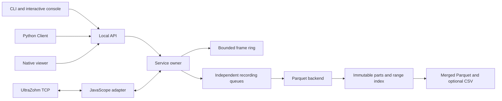

# Acquisition architecture

The CLI, Python API and native Data Viewer share a Rust acquisition service.
This document describes implementation ownership and invariants. User commands,
file layouts and configuration examples live in the [usage guide](../README.md);
the device and local API contracts live in [protocol.md](protocol.md).

## Components

| Module | Responsibility |
|---|---|
| `cli.rs`, `python.rs` | CLI/PyO3 adapters to the same service and query operations |
| `service.rs` | Startup, session ownership, control dispatch and ordered shutdown |
| `protocol.rs`, `profile.rs`, `header_mapping.rs` | Wire codec, validated configuration and header parsing |
| `live.rs`, `data.rs` | Bounded frame retention and captured range/query views |
| `recording.rs` | Independent fast/slow recording lifecycles and routing |
| `storage.rs`, `backend.rs` | Frame conversion, durable indexed chunks and derived exports |
| `vitis.rs` | Local build/generation/JTAG tool invocation |

`Service` owns configuration, connection, recordings, audit and query workers on
the control thread. Its shared `ConnectionContext` contains synchronized state
needed by acquisition. Binding the local endpoint precedes touching the device,
whose firmware replaces an existing client when a new one connects. Initial
observable selections complete before startup signals readiness.

The receiver frames TCP data, updates a bounded ring and routes immutable
`Arc<Frame>` payloads into recording queues. One writer mutex serializes commands
and ACKs independently of receive progress. Control requests do not wait for a
new data frame. Socket timeouts and the five-second no-progress timeout bound
stalls; commands are never automatically replayed.

## Process and UI ownership

The standalone CLI needs no Python runtime. `serve` owns acquisition independently
of short-lived commands. Python `Client` releases the GIL during native socket
calls. `Acquisition` runs the same service in a native thread and waits for startup
readiness; its lifetime is bounded by Python. `close()` joins finalizers and
surfaces errors. Use an external service when logging must outlive Python.

The viewer uses the same API for source and frozen builds. Its controller owns
background requests and a service process only when it launched that process;
attaching does not transfer ownership. Script documents/file dialogs, script
workers and live controls have separate owners. Plotting and analysis share
source/query abstractions with recorded measurements. See the
[viewer README](../../uz_dataviewer/README.md) for its runtime boundaries.

Developer and frozen modes use separate workspace data directories. A shared
settings loader seeds missing files, reads the mapping and preferences once,
and derives session profiles without rewriting saved choices. Bundled code and
templates are read-only inputs. The native console and Python automation remain
available on Windows and Linux; only the viewer's `uz` shortcut is Linux-only.
The browser viewer retains its offline analysis role and does not launch native
acquisition/tool workers.

## Recording and shutdown invariants

Fast and slow recorders start idle. Start installs a bounded queue under the same
routing mutex used by the receiver. Stop removes that queue at a complete frame
boundary; queued frames drain and export on its worker. One stream's finalization
does not block device control or the other stream. Restart waits for that stream's
previous finalizer. Pausing keeps its handle while omitting incoming frames.

Observable assignment is locked while either recording is active or paused.
Each recording freezes requested column names; duplicate observable IDs use their
first selected slot. Labels are unconfirmed requests because the firmware has
no assignment acknowledgment. Changing live assignments clears retained history
and invalidates old live cursors.

Each logger has a 2,048-frame queue and defaults to a 1,000,000-row batch target
or a 60-second flush interval. Flush resets the timer and rounds to complete
frames. At 10 kHz with 15 samples/frame, the queue is 3.072 seconds of headroom
and interval flushing normally produces 600,000 rows. Disk delay can extend
publication latency. These bounds are independent of the 30-second live ring.
The ring can retain one partial extra frame but exposes its exact sample limit.
Header validation caps samples/frame at 4096.

Recording initialization and audit writes use workers too. The audit queue is
bounded; full/failed queues and recording I/O failures are terminal errors,
never silent losses. Recording queries may report initialization in progress
until their backend reader becomes available.

Every service exit path attempts device Stop before waiting for data queries,
receiver completion, recording finalizers and audit draining. A Stop failure is
recorded while finalization continues. The shutdown reply acknowledges acceptance;
process exit and `end.json` report completion and errors. This ordering applies
to explicit shutdown, Ctrl-C, EOF, embedded close and acquisition failure.

## Canonical storage and queries

`RecordingBackend` owns append/reader/finish; `RecordingReader` supplies metadata
and projected ranges. Parquet is the only registered backend. An injected memory
backend tests the contract independently of storage files; backend choice is
separate from the optional CSV export format.

Chunks and their `*.recording.json` index are published atomically. The persisted
boundary advances only after both succeed. Canonical parts remain after export,
so concurrent readers do not race deletion. Index/footer metadata grows with
chunk count; sample buffers stay bounded. Merged Parquet and CSV are additional
exports, not replacements for canonical history. Finalization reads one segment
at a time; CSV conversion reads at most 65,536 rows per slice.

`DataView` captures a persisted prefix and pending suffix at one boundary, then
reads/serializes outside the receiver lock. It joins them without duplicates or
gaps. Pending retention is bounded by the writer batch plus queue headroom and
shares immutable frames with ingestion. Queries pin only their requested live
window; metadata queries do not pin samples.

Projection resolves requested column order, deduplicates signals and includes
mandatory time/status before disk I/O. Polars receives both column selection and
row slices. Pending frames use the same schema. Responses use Arrow IPC, with a
128 MiB cap; up to four background query workers leave control requests available.

Live positions count acquisition samples; recording positions count accepted
rows, anchored at their first acquisition position. Cursors identify run, source,
recording and live mapping generation. Paused intervals remain gaps in timestamps,
not in recorded-row pagination. Durable `Recording` handles read indexed data
without a running service, including committed prefixes of incomplete runs.
Clients of a running service can additionally read pending samples.

Canonical slow history stores rotating ID/value updates. Wide forward-filled
slow Parquet/CSV files are derived exports: they wait for all observables, reset
filling after pauses, and preserve received NaN/Inf. Their held values must not be
interpreted as simultaneous new measurements. The raw history remains available.

## Failure and protocol boundaries

Queue overflow, failed writes and failed exports are explicit errors. Successful
backend completion is distinct from export completion: export failure preserves
canonical data, although status/close still fail. Complete chunks survive a
process kill; pending batches can be lost and `.partial` files may remain.
Automatic repair is not implemented. Data-file fsync does not provide universal
transactional directory durability across host filesystems.

Firmware provides no sample sequence counter, precise acquisition clock or command
receipt. Nominal time is derived from received samples and the configured period;
packet arrival time is not the measurement clock. State feedback is the latest
received mapped status, not a command acknowledgment. Legacy firmware headers
without platform-state definitions remain supported with state unavailable.
These limitations belong to the device adapter, not the CLI version.

## Deferred work

- Live subscriptions require transport/backpressure benchmarks across native,
  Windows and browser clients; reuse columnar data rather than per-value JSON.
- Sparse slow exports need explicit null/update semantics, matching viewer
  support and deliberate time-alignment/resampling policies for analysis.
- Module-level Python build/flash/header-generation helpers should call existing
  Rust tools, release the GIL, propagate failures and define workspace exclusion.
- Ceedling/cloud adapters need provenance, resumable upload and authenticated API
  access. Local recording must remain usable without cloud access.
- Future firmware framing, sequence counters, clocks and command receipts can
  improve integrity without replacing the named control/query API.
