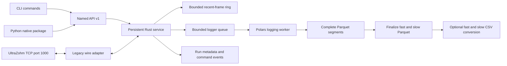

# Implementation plan and platform boundary

The objective is one UltraZohm data platform: a common run/signal model across
live sessions, local measurements, Ceedling results and cloud recordings.
Acquisition, persistence and presentation must have independent lifecycles.
This change implements the headless acquisition/control foundation only.

## Implementation stages

1. Trace JavaScope → TCP → FreeRTOS queue → IPI → Baremetal dispatch and freeze
   the existing protocol in `protocol.md` and a runtime profile and versioned firmware channel mapping.
2. Isolate the Rust wire codec from named operations. Reject unknown names,
   invalid float values, unsupported profiles and invalid channel assignments.
3. Implement a persistent connection owner with concurrent receive/control,
   background zero ACK policy, bounded history and an independent logging worker.
4. Expose a standalone CLI and a Python package backed by the same Rust library.
   Keep Python outside the ingestion and Polars write paths.
5. Publish complete Parquet segments, run metadata and command events. At the
   end, merge each stream into one Parquet and optionally convert each to CSV.
6. Correct the simulator's TCP handling and firmware defaults, then test normal
   operation, faults, invalid inputs, ACK modes, and live file reads.
7. Add pinned Rust tooling to the devcontainer and Linux/Windows CI builds/tests.

These stages are represented in the implementation and tests in this directory.
Validation results and remaining platform limitations are recorded in README.

## Components

The reader owns receive framing and a bounded sample ring (960 samples by default).
Snapshots clone only references to immutable frames while holding the ring lock, then build
and serialize independent Arrow data after releasing it. Retention is configurable
with `buffer_samples`; the physical ring may retain one partial extra frame.
Successful channel-selection commands clear the ring; firmware-buffered samples
remain unconfirmed. A mutex serializes
all command/ACK writes, independently of receive progress. Each active logger consumes its own
2,048-frame bounded queue and writes batches of about 1,000,000 rows or every
60 seconds by default. At 10 kHz with 15-sample frames this produces roughly one
600,000-row chunk per minute, and the queue provides 3.072 seconds of headroom
while the worker encodes and syncs a chunk. The queue is separate from live history.
`segment_rows` and `flush_interval_ms` configure the chunk thresholds. Every
size-triggered flush resets the interval timer, preventing an extra timer-driven
small segment immediately afterward.
Sample buffers do not grow with recording duration. During finalization, Parquet
footer metadata grows with the number of row groups; the full sample data is not
loaded into RAM. Default frame payload is 1324 bytes; Rust decoded allocations
and Polars working buffers add overhead.
Channel mappings cap samples/frame at 4096 to bound even misconfigured allocations.

A full logger queue is a terminal, recorded acquisition error. It is never an
unreported sample drop. On ordinary shutdown or network error, the logger drains
queued frames, commits its final segment, merges all segments and optionally
exports CSV. A recording interrupted by a network error can have valid final
files while `end.json` still reports the acquisition error.

A disk write failure is terminal. Merge and CSV export failures retain all source
segments, plus the final Parquet if already published. A process kill/power failure
can lose uncommitted memory (normally up to one minute plus queue/write delays with
the defaults) and leave `.partial` files; complete segments remain
available for recovery. No automatic recovery command is implemented yet.
Directory-entry durability across power loss depends on the host filesystem;
fsync of data files is not a universal transactional guarantee.

Control is serialized and bounded. Commands do not wait for another data frame.
Socket read/write timeouts and a five-second no-progress timeout bound stalls.
No automatic replay/reconnection occurs. Device-side queue loss and overflow
framing problems remain explicit limitations of the unchanged protocol.

## Storage decision

**Parquet is the initial persistent measurement format, with optional CSV.**
Polars writes both in Rust. DuckDB can later be an optional query/catalog layer
over those Parquet datasets; it need not be another writer-owned database.

A session directory is reserved at service startup but both recorders start idle.
The four start/stop logging operations control fast and slow data independently.
Each recording owns a bounded queue and worker. Start installs its queue under the
same mutex used by acquisition to dispatch complete frames. Stop removes it under
that mutex: accepted frames drain, then finalization proceeds on the recording's
worker. Device control and the other recording do not wait for disk finalization.

Status exposes each stream's phase, Parquet path and error. Restart is allowed only
after the previous worker completes. Files use independent counters: `data.parquet`,
`data_0002.parquet`, etc. for fast, and `data_slow_data.parquet`,
`data_0002_slow_data.parquet`, etc. for slow. Segments use `<stem>-part-00000000.parquet`.
Each `<stem>.json` captures requested observable assignments and later completion
and row count. Never-started streams have no output; empty started streams remain
valid recordings. Duplicate start/stop requests return errors without changing state.

A recording's stop reply acknowledges detachment, not completed export. Wait for
`logging.fast.phase` or `logging.slow.phase` to become `complete`. Shutdown / Python
`close()` joins all workers. Disk errors remain terminal service errors. Finalization
retains a recording's source segments until its own Parquet and optional CSV succeed;
other independently completed recordings need not retain their segments.

Run schema version 4 exports these columns:

| File | Columns |
|---|---|
| Fast | `time` (float64 seconds), `status` (uint32), one column per selected observable name (float32; no channel prefixes) |
| Slow (final) | `time`, `status`, one float32 column per slow observable, ordered by ID; values forward-filled from received updates |

Slow segments retain the raw `observable`, `slow_id`, `slow_raw`, and `slow_value`
columns. Merge converts them to wide output while carrying the last value across
segments. Rows with missing values are dropped after filling; output starts once
all observables have been received in that recording, or stays empty if any are
never received. CSV
is exported from the finalized wide Parquet. Metadata schema version 5 identifies
this layout; held values are not new samples at the row timestamp.

`time` is the received sample ordinal since acquisition began multiplied by the
configured period. Starts/stops do not reset the clock. Internal exact counters
validate ingest continuity; final merges validate nominal times, schemas and row
counts without exporting those counters. Device-side gaps remain undetectable.
Slow records are individual rotating updates, including ID 0, not forward-filled
snapshots. Independent start/stop means fast/slow row counts can differ.

`set_observable` is rejected before sending bytes whenever either recorder has an
active input queue. Stopping both releases the restriction even if files are still
finalizing. The recording's requested mapping is immutable, but the protocol has
no acknowledgment or mapping epoch: buffered old samples can appear after a prior
selection. Log columns use the requested observable names, frozen at recording start;
sidecars state that the requested mapping is unconfirmed. Duplicate observable IDs
are recorded once using the first selected slot, and unknown slots are omitted.
This makes CSV and Parquet independently readable without metadata lookup, while
retaining the firmware's lack of acknowledged sample boundaries. Fast logging with
no known selections is rejected. Channel-mapping observable IDs are signal identifiers,
not slot numbers. Writable variables have a separate send-field map.

`run.json` stores the validated combination of runtime profile and channel mapping,
including initial selections, mapping name, repository provenance, source, software
version and host start time.
`commands.jsonl` still records host times for control audit (these are not sample
columns). Metadata does not invent device firmware versions or precise mapping
boundaries. Prior schema versions are not modified.

## Python and process ownership

The standalone executable has no Python, Java, GUI or database-service runtime
dependency. `serve` owns acquisition; commands in other terminals exit after the
local response. Use an OS process supervisor for unattended operation.

Python `Client` uses a PyO3 native extension, releases the GIL during socket calls,
and talks to an existing service. `Acquisition` optionally runs the very same
Rust service in a native thread inside Python, also with no Python sample loop. The
constructor waits (without holding the GIL) until the service and optional device
connection are ready, and raises startup errors immediately. It shares CLI session
path resolution and defaults to CSV plus Parquet, with logging initially off.
`Acquisition.output` exposes the resolved session directory.
An embedded service ends with its Python process; use the external executable
when logging must outlive Python as well as the GUI. The wheel and standalone
binary are separate deliverables.

## Recording backend and query interfaces

`backend.rs` defines `SampleBatch` (absolute first sample plus a Polars DataFrame),
`RecordingBackend` (append, reader, finish), and concurrent `RecordingReader`
(info, range read). Only `ParquetBackend` is registered today. `LogWriter` converts
legacy frames into columns and exports complete Parquet/CSV through that interface;
its injectable factory is tested with a second, in-memory backend. A future local
or remote backend implements these traits without changing query callers.

`data.rs` captures a source view, then combines its persisted prefix and pending
suffix outside the receiver lock. All ranges use acquisition sample indices,
not floating-point timestamp comparisons. `History` tracks accepted and committed
positions. Queues, batching, pending views and live history reference the same
immutable `Arc<Frame>` payload. Pending retention is bounded by the rounded batch
limit plus queue headroom; it does not grow with recording length.

Every recording has an atomically published `*.recording.json` backend/schema/range
index and immutable Parquet parts. Publication advances only after the chunk and
index writes succeed. Canonical parts remain after finalization so concurrent
readers never race with deletion; merged Parquet and optional CSV are additional
exports. Index size grows with chunk count, not sample count. Python `Recording`
opens this handle without a service, including the committed prefix of an incomplete
run. Backend completion and compatibility export are separate operations: export
errors do not invalidate canonical measurement data. Complete acquisition helpers require close and a successful backend finish.
Slow canonical history preserves original updates; wide forward-filled slow files
are derived exports. This avoids inventing simultaneous slow observations.

The API offers RAM/recording `tail`, `read_range`, `read_since`, data metadata,
and a recording catalogue. At most four background workers perform data reads and
serialization, leaving control requests independent of history I/O. Only the
requested RAM window is pinned by a query; metadata queries pin no sample buffers.
A response includes an opaque run/source/generation
cursor and a captured available/persisted range. Live schema changes invalidate
old cursors; a recording's schema and identity remain fixed. Python returns Polars
DataFrames or a DataPage containing both rows and cursor. CLI previews use the
same Arrow IPC operation. Requests stay bounded to 128 MiB; callers page history.
GUI integration, subscription transports and cloud authentication/upload remain
separate implementation stages. Current pending data can be lost on process failure.

## Deferred platform work

No `uz_dataviewer` integration is added. A bounded request/reply live snapshot API
is available to Python and CLI clients over the existing loopback TCP endpoint:
small JSON metadata followed by binary Arrow IPC stream bytes. Python exposes
Polars DataFrames; the CLI prints a limited table preview. NNG/WebSocket live
subscriptions remain deferred. Cursors and combined RAM/backend history use this same endpoint.
The existing imgui_bundle/ImPlot viewer remains the intended single UI for live,
local, test and cloud data. It should depend on run/signal/query interfaces,
not legacy TCP offsets or a particular physical database.

Future steps:

- Define shared Run, Signal, sample-batch, provenance, quality/gap and schema-epoch
  objects. Map slot data plus profile metadata without claiming unavailable
  device timestamps or command acknowledgments.
- Add a live batch subscription adapter. Decide NNG versus WebSocket after
  benchmarking local throughput, Python/browser clients, Windows packaging and
  backpressure. Loopback JSON carries control and snapshot metadata; snapshot
  samples already use binary Arrow IPC. Reuse that columnar interchange contract
  for future subscriptions rather than serializing per-value JSON.
- Add GUI source adapters to the implemented cursor/range interface. Full history
  is available only for enabled recordings; reduce/FFT data in the analysis layer.
- Emit Ceedling structured runs locally first, including Git commit, test name,
  timestamps and measurements; normalize into the same model. A separate uploader
  handles retry/idempotency and network absence.
- Implement FastAPI upload/query endpoints authenticated via OIDC/OAuth2 for CLI
  and desktop. ClickHouse stays behind the API for concurrent cloud analysis.
  Upload complete segments or recordings with run IDs and content identities. No client database
  credentials or direct database access.
- Deployment may use per-customer Docker Compose on Hetzner and optional
  Cloudflare access. Local logging must remain usable without auth/cloud/network.

Future firmware changes can replace only the legacy adapter while preserving
named operations. Negotiated schema, sequence counters, precise sample clocks,
explicit command receipts and framed/checksummed batches would resolve the
integrity limitations documented in `protocol.md`.

## Comparison with JavaScope logs

The four CSV fixtures in `javascope/test_logs` have `time` followed by 20 labeled
channel columns, separated by semicolons. Adjacent times advance by 0.0001 seconds;
recordings can begin at nonzero times (for example 13.119 or 885.168 seconds).
`ReceiveController.java` derives time from `generalDataCounter + packetSampleIndex`
and `logTimeStep_usec`, then rounds it for output. The current Java logger can also
append sparse slow-signal columns; the supplied CSV examples contain fast data only.

Our `time` keeps the same nominal sample-counter-times-period model, in seconds
from acquisition start, with float64 precision. Recording files can begin at
nonzero times because logging starts explicitly after acquisition. The default
profile period is 100 microseconds and must match deployed firmware. Neither
implementation can reconstruct device-side gaps from this protocol. CSV remains
comma-delimited rather than byte-for-byte JavaScope semicolon compatibility.

The former `sample_index` and `host_received_unix_ns` sample columns were removed
at user request. The exact counter remains internal for integrity checks. Packet
arrival time is not used as the measurement clock.

## Startup configuration

`profiles/standard.json` is the default runtime profile: schema version, name,
sample period and initial slot selections. `channel_mappings/default.json` holds
firmware wire geometry, API version, mapping name, repository name/commit and all
numeric signal/command IDs and the platform-state bit mask, shift, and value names.
Status decoding uses this mapping for both CLI and Python responses.
`Profile::load_files` combines and validates the two
before the service touches a device. Each omitted file uses its embedded default.
The CLI can export each default independently with `profile` and `channel-mapping`.

Initial selections are sent before the command loop becomes ready, after exclusive
endpoint ownership and device connection. There are no automatic enable or logging
commands. Startup writes populate the same tracked assignment state used by manual
selections and recording snapshots. The default uses IDs 1..20; an explicit empty
or omitted initial map in a custom profile opts out. No API readback is invented.
The standard profile is separate from the firmware tables so multiple measurement
setups can reuse a single mapping without duplicating firmware IDs/provenance.

## TODO: Sparse slow-data output and uz_dataviewer support

This is future work. The current logger exports wide, forward-filled slow data
and drops incomplete rows during finalization. Keep that behavior until sparse
output and viewer support are designed and implemented together.

- Add an explicit sparse slow-output mode for final CSV and Parquet, using the
  same `time`, `status`, and observable column names. Each row contains only the
  slow observable actually received at that time; other observable cells are
  null (empty in CSV). Preserve initial partial cycles and never-received columns.
  Do not forward fill or drop incomplete rows in sparse mode: such rows are the
  expected representation of rotating updates.
- Record the layout and missing-value semantics in versioned metadata so readers
  can distinguish sparse updates from held values. A null means no update for
  that observable at this row, not zero or an invalid measurement. Preserve
  explicitly received NaN/Inf separately from nulls. Timestamps remain nominal
  received-sample times; sparse output does not add a hardware clock or identify
  updates lost before reception.
- Change `uz_dataviewer`'s data model to support a separate time/value series for
  each slow observable instead of assuming every table row samples every signal.
  Extract each series from its non-null updates while retaining the corresponding
  `time`. Keep row-level status associated with its original timestamp. Align
  fast and slow data by time, not by row number or equal row counts.
- Make plotting distinguish sampled points, optional connecting lines, and
  explicitly requested sample-and-hold views. Structural nulls should not create
  artificial gaps between successive updates of one slow observable; genuine
  invalid samples should remain distinguishable. Never present a held value as a
  newly sampled value. Show sampling times or value age where needed.
- Make calculations choose an alignment policy explicitly. Cross-signal math
  needs time alignment or resampling; interpolation and forward fill must be
  deliberate operations with documented boundary and gap handling. FFT must use
  each signal's actual time spacing, validate uniform sampling, and require an
  explicit resampling step when necessary. Histograms/statistics should use
  received updates by default, avoiding accidental weighting by repeated held
  values; any time-weighted analysis should be explicit.
- Preserve nulls during CSV/Parquet loading (including conversion to NumPy), and
  define consistent pandas/Polars examples for extracting updates and optional
  resampling. Do not silently conflate missing updates with received NaN values.
- Add logger/viewer compatibility tests for recordings starting mid-cycle,
  never-received observables, empty recordings, segment boundaries, invalid
  values, and differing fast/slow timestamps. Verify equivalent CSV/Parquet
  interpretation and continued support for existing forward-filled recordings.

## TODO: Python access to local tooling

- Expose module-level Python functions for the existing local CLI commands:
  `build`, `build_clean`, `flash`, `generate` (including opening the GUI),
  `create_json_from_javascope_h`, `profile`, and `channel_mapping`.
  Keep device-control operations on `Client` and embedded service ownership on
  `Acquisition`; local tools should not require an acquisition service.
- Reuse the Rust implementations. Return dictionaries/paths for configuration
  operations; stream build output and raise Python exceptions on tool failures.
  Release the GIL during blocking tool execution.
- Add optional `repo` and `tool_path` parameters, with matching CLI options.
  Resolve the Vitis installation's XSCT launcher and required Make/compiler
  environment on Linux and Windows; retain environment/PATH discovery when omitted.
- Prevent concurrent operations against one workspace. Document stopping and
  closing acquisition before flashing, then reconnecting after programming.
- Test Python/CLI parity, paths with spaces, absent tools, failed builds,
  unchanged builds, and interruption without requiring attached hardware.

These Python tooling functions and tool-path overrides are planned, not implemented.
