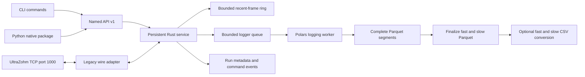

# Implementation plan and platform boundary

The objective is one UltraZohm data platform: a common run/signal model across
live sessions, local measurements, Ceedling results and cloud recordings.
Acquisition, persistence and presentation must have independent lifecycles.
This change implements the headless acquisition/control foundation only.

## Implementation stages

1. Trace JavaScope → TCP → FreeRTOS queue → IPI → Baremetal dispatch and freeze
   the existing protocol in `protocol.md` and a runtime profile and versioned firmware channel mapping.
2. Isolate the Rust wire codec from named operations. Reject unknown names,
   invalid float values, unsupported profiles and invalid channel assignments.
3. Implement a persistent connection owner with concurrent receive/control,
   background zero ACK policy, bounded history and an independent logging worker.
4. Expose a standalone CLI and a Python package backed by the same Rust library.
   Keep Python outside the ingestion and Polars write paths.
5. Publish complete Parquet segments, run metadata and command events. At the
   end, merge each stream into one Parquet and optionally convert each to CSV.
6. Correct the simulator's TCP handling and firmware defaults, then test normal
   operation, faults, invalid inputs, ACK modes, and live file reads.
7. Add pinned Rust tooling to the devcontainer and Linux/Windows CI builds/tests.

These stages are represented in the implementation and tests in this directory.
Validation results and remaining platform limitations are recorded in README.

## Components

The reader owns receive framing and a bounded 64-frame ring. A mutex serializes
all command/ACK writes, independently of receive progress. Each active logger consumes its own
128-frame bounded queue and writes batches of about 4096 rows or every 500 ms.
Sample buffers do not grow with recording duration. During finalization, Parquet
footer metadata grows with the number of row groups; the full sample data is not
loaded into RAM. Default frame payload is 1324 bytes; Rust decoded allocations
and Polars working buffers add overhead.
Channel mappings cap samples/frame at 4096 to bound even misconfigured allocations.

A full logger queue is a terminal, recorded acquisition error. It is never an
unreported sample drop. On ordinary shutdown or network error, the logger drains
queued frames, commits its final segment, merges all segments and optionally
exports CSV. A recording interrupted by a network error can have valid final
files while `end.json` still reports the acquisition error.

A disk write failure is terminal. Merge and CSV export failures retain all source
segments, plus the final Parquet if already published. A process kill/power failure
can lose uncommitted memory and leave `.partial` files; complete segments remain
available for recovery. No automatic recovery command is implemented yet.
Directory-entry durability across power loss depends on the host filesystem;
fsync of data files is not a universal transactional guarantee.

Control is serialized and bounded. Commands do not wait for another data frame.
Socket read/write timeouts and a five-second no-progress timeout bound stalls.
No automatic replay/reconnection occurs. Device-side queue loss and overflow
framing problems remain explicit limitations of the unchanged protocol.

## Storage decision

**Parquet is the initial persistent measurement format, with optional CSV.**
Polars writes both in Rust. DuckDB can later be an optional query/catalog layer
over those Parquet datasets; it need not be another writer-owned database.

A session directory is reserved at service startup but both recorders start idle.
The four start/stop logging operations control fast and slow data independently.
Each recording owns a bounded queue and worker. Start installs its queue under the
same mutex used by acquisition to dispatch complete frames. Stop removes it under
that mutex: accepted frames drain, then finalization proceeds on the recording's
worker. Device control and the other recording do not wait for disk finalization.

Status exposes each stream's phase, Parquet path and error. Restart is allowed only
after the previous worker completes. Files use independent counters: `data.parquet`,
`data_0002.parquet`, etc. for fast, and `data_slow_data.parquet`,
`data_0002_slow_data.parquet`, etc. for slow. Segments use `<stem>-part-00000000.parquet`.
Each `<stem>.json` captures requested observable assignments and later completion
and row count. Never-started streams have no output; empty started streams remain
valid recordings. Duplicate start/stop requests return errors without changing state.

A recording's stop reply acknowledges detachment, not completed export. Wait for
`logging.fast.phase` or `logging.slow.phase` to become `complete`. Shutdown / Python
`close()` joins all workers. Disk errors remain terminal service errors. Finalization
retains a recording's source segments until its own Parquet and optional CSV succeed;
other independently completed recordings need not retain their segments.

Run schema version 4 exports these columns:

| File | Columns |
|---|---|
| Fast | `time` (float64 seconds), `status` (uint32), one column per selected observable name (float32; no channel prefixes) |
| Slow | `time`, `status`, `observable` (string signal name), `slow_id` (uint32), `slow_raw` (uint32), `slow_value` (float32) |

`time` is the received sample ordinal since acquisition began multiplied by the
configured period. Starts/stops do not reset the clock. Internal exact counters
validate ingest continuity; final merges validate nominal times, schemas and row
counts without exporting those counters. Device-side gaps remain undetectable.
Slow records are individual rotating updates, including ID 0, not forward-filled
snapshots. Independent start/stop means fast/slow row counts can differ.

`set_observable` is rejected before sending bytes whenever either recorder has an
active input queue. Stopping both releases the restriction even if files are still
finalizing. The recording's requested mapping is immutable, but the protocol has
no acknowledgment or mapping epoch: buffered old samples can appear after a prior
selection. Log columns use the requested observable names, frozen at recording start;
sidecars state that the requested mapping is unconfirmed. Duplicate observable IDs
are recorded once using the first selected slot, and unknown slots are omitted.
This makes CSV and Parquet independently readable without metadata lookup, while
retaining the firmware's lack of acknowledged sample boundaries. Fast logging with
no known selections is rejected. Channel-mapping observable IDs are signal identifiers,
not slot numbers. Writable variables have a separate send-field map.

`run.json` stores the validated combination of runtime profile and channel mapping,
including initial selections, mapping name, repository provenance, source, software
version and host start time.
`commands.jsonl` still records host times for control audit (these are not sample
columns). Metadata does not invent device firmware versions or precise mapping
boundaries. Prior schema versions are not modified.

## Python and process ownership

The standalone executable has no Python, Java, GUI or database-service runtime
dependency. `serve` owns acquisition; commands in other terminals exit after the
local response. Use an OS process supervisor for unattended operation.

Python `Client` uses a PyO3 native extension, releases the GIL during socket calls,
and talks to an existing service. `Acquisition` optionally runs the very same
Rust service in a native thread inside Python, also with no Python sample loop.
An embedded service ends with its Python process; use the external executable
when logging must outlive Python as well as the GUI. The wheel and standalone
binary are separate deliverables.

## Deferred platform work

No `uz_dataviewer` code or live data IPC connection is added in this change.
The existing imgui_bundle/ImPlot viewer remains the intended single UI for live,
local, test and cloud data. It should depend on run/signal/query interfaces,
not legacy TCP offsets or a particular physical database.

Future steps:

- Define shared Run, Signal, sample-batch, provenance, quality/gap and schema-epoch
  objects. Map slot data plus profile metadata without claiming unavailable
  device timestamps or command acknowledgments.
- Add a live batch subscription adapter. Decide NNG versus WebSocket after
  benchmarking local throughput, Python/browser clients, Windows packaging and
  backpressure. Current loopback JSON is only a control transport; bulk samples
  must not be serialized as per-value JSON. Arrow record batches are the intended
  columnar interchange boundary.
- Query history from active Parquet segments and completed recordings, with optional DuckDB indexing.
  Merge history and recent RAM samples using recording identity and nominal `time` ranges,
  deduplicate their overlap and expose a committed-history watermark. Keep data
  reduction/FFT in the analysis layer rather than acquisition.
- Emit Ceedling structured runs locally first, including Git commit, test name,
  timestamps and measurements; normalize into the same model. A separate uploader
  handles retry/idempotency and network absence.
- Implement FastAPI upload/query endpoints authenticated via OIDC/OAuth2 for CLI
  and desktop. ClickHouse stays behind the API for concurrent cloud analysis.
  Upload complete segments or recordings with run IDs and content identities. No client database
  credentials or direct database access.
- Deployment may use per-customer Docker Compose on Hetzner and optional
  Cloudflare access. Local logging must remain usable without auth/cloud/network.

Future firmware changes can replace only the legacy adapter while preserving
named operations. Negotiated schema, sequence counters, precise sample clocks,
explicit command receipts and framed/checksummed batches would resolve the
integrity limitations documented in `protocol.md`.

## Comparison with JavaScope logs

The four CSV fixtures in `javascope/test_logs` have `time` followed by 20 labeled
channel columns, separated by semicolons. Adjacent times advance by 0.0001 seconds;
recordings can begin at nonzero times (for example 13.119 or 885.168 seconds).
`ReceiveController.java` derives time from `generalDataCounter + packetSampleIndex`
and `logTimeStep_usec`, then rounds it for output. The current Java logger can also
append sparse slow-signal columns; the supplied CSV examples contain fast data only.

Our `time` keeps the same nominal sample-counter-times-period model, in seconds
from acquisition start, with float64 precision. Recording files can begin at
nonzero times because logging starts explicitly after acquisition. The default
profile period is 100 microseconds and must match deployed firmware. Neither
implementation can reconstruct device-side gaps from this protocol. CSV remains
comma-delimited rather than byte-for-byte JavaScope semicolon compatibility.

The former `sample_index` and `host_received_unix_ns` sample columns were removed
at user request. The exact counter remains internal for integrity checks. Packet
arrival time is not used as the measurement clock.

## Startup configuration

`profiles/standard.json` is the default runtime profile: schema version, name,
sample period and initial slot selections. `channel_mappings/default.json` holds
firmware wire geometry, API version, mapping name, repository name/commit and all
numeric signal/command IDs. `Profile::load_files` combines and validates the two
before the service touches a device. Each omitted file uses its embedded default.
The CLI can export each default independently with `profile` and `channel-mapping`.

Initial selections are sent before the command loop becomes ready, after exclusive
endpoint ownership and device connection. There are no automatic enable or logging
commands. Startup writes populate the same tracked assignment state used by manual
selections and recording snapshots. The default uses IDs 1..20; an explicit empty
or omitted initial map in a custom profile opts out. No API readback is invented.
The standard profile is separate from the firmware tables so multiple measurement
setups can reuse a single mapping without duplicating firmware IDs/provenance.
